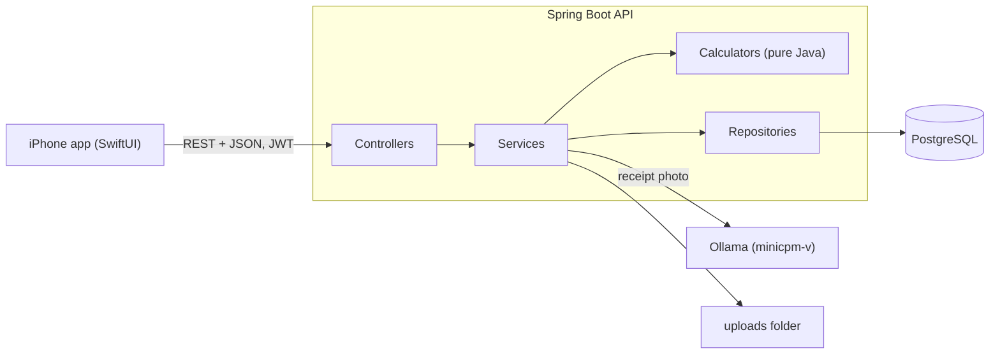

Economofar API
==============


The REST API behind the Economofar iPhone app. It keeps the receipts that the app scans, reads them with a local vision model, and turns them into budgets and seventeen analyses of where the money goes.

The iPhone app is in the folder economofar next to this one.

What it does
------------

- Receipts: upload a photo, read it with a vision model (Ollama), check and correct the lines, categories, payment method, notes and warranty date, duplicate or delete a receipt, export to PDF and CSV, accountant export.
- History: search, filters, grouping by month, monthly report, scan status that survives an interrupted scan.
- Budgets: a monthly budget with day by day tracking, a budget for each category, incomes that feed the needs / wants / savings split, a notification when a budget is exceeded.
- Analyses, all computed from the saved tickets: unusual purchases, spending rhythm, ticket quality, month against month, year review, category trends and profiles, small purchases, suggested categories, warranties, payment methods, needs / wants / savings split, price of each article, spending events, shops, regular purchases.
- Business: VAT, deductible and reimbursable amounts, expense reports, projects and clients.
- Account: sign up and sign in with JWT, profile, password, notification preferences, help and support.

Architecture
------------



Every analysis has the same three parts: a controller that exposes it, a service that reads the saved tickets of the signed in user (read only transaction), and a calculator that does the work. The calculators are plain Java classes with no Spring in them: they take lists and a date and return records. That is what makes them easy to test, and it is why the same input always gives the same answer.

Design notes
------------

- Calculators are pure: no database, no clock (today is a parameter), no randomness. The tests give them the lines in a different order and expect the same answer.
- Money is a BigDecimal rounded to the cent in the analyses. A ticket total is the sum of its lines.
- Every query is limited to the signed in user. Passwords are hashed with BCrypt and the API is stateless.
- Dirty data is expected, because it comes from OCR: unknown shops, missing categories, duplicates, lines without a price. Each calculator says how it treats them, and there is an analysis (ticket quality) that points them out.
- The demo account is generated by a pure factory too, so the numbers of the demo can be checked in tests.

Run it with Docker
------------------

You only need Docker. From the folder economorfar_api:

```
docker compose up --build
```

This builds the image of the API (the first time takes a few minutes, because Maven downloads the libraries), starts PostgreSQL, waits until it is ready, then starts the API with the demo profile: the demo account and fourteen months of receipts are created the first time. The API listens on http://localhost:8080 and PostgreSQL on port 5433 of your computer only. Stop everything with docker compose down. Add -v to also delete the database and the uploaded images, which gives fresh demo dates the next time.

The settings, all optional:

| Variable | Use |
| --- | --- |
| JWT_SECRET | The key that signs the tokens, taken from your .env file or the environment. Without it the API makes a temporary key at each start, and everybody is signed out when it restarts. To make one: openssl rand -base64 48 |
| JWT_EXPIRATION_HOURS | How long a token lasts, 168 hours (7 days) by default. |
| OLLAMA_URL_IN_DOCKER | Where the container finds Ollama, to scan new receipts. By default http://host.docker.internal:11434/api/generate, the Ollama that runs on your computer. |
| OLLAMA_MODEL | The vision model, minicpm-v by default. |
| OLLAMA_TIMEOUT_SECONDS | How long the API waits for Ollama, 180 seconds by default. |
| ECONOMOFAR_PROFILE | demo by default. Use none for an empty database without demo data: ECONOMOFAR_PROFILE=none docker compose up --build |
| ECONOMOFAR_TIMEZONE | The time zone of the container, UTC by default. The API reads today's date from it, so set your own zone to avoid a one day gap around midnight: ECONOMOFAR_TIMEZONE=Europe/Paris docker compose up |

The container runs as a user without rights. The .env file and the uploads folder are never copied into the image, and the uploaded images live in a Docker volume. The API uses port 8080: stop the one that you started with mvn spring-boot:run first.

To check a running stack (the sign-in of the demo account, three requests with the token, one without, and a write test of the uploads folder):

```
sh scripts/docker-smoke-test.sh
```

Run it locally
--------------

You need JDK 25, Maven 3.9 or later and Docker. Scanning a new receipt also needs Ollama with the minicpm-v model; the demo data does not.

Start PostgreSQL on port 5433, so that it does not clash with a PostgreSQL you may already run:

```
docker compose up -d db
```

Start the API with the demo profile, which creates the demo account and fourteen months of receipts the first time:

```
export SPRING_DATASOURCE_URL=jdbc:postgresql://localhost:5433/economofar
export SPRING_DATASOURCE_USERNAME=economofar
export SPRING_DATASOURCE_PASSWORD=economofar
export SPRING_JPA_HIBERNATE_DDL_AUTO=update
export SPRING_PROFILES_ACTIVE=demo
mvn spring-boot:run
```

The API listens on http://localhost:8080. Without the demo profile nothing is created, and the settings of application.properties are used as they are.

Demo account
------------

| E-mail | Password |
| --- | --- |
| demo@economofar.app | Demo2026Pass |

The account has about 490 receipts over 14 months in about 30 shops: a weekly shop, a baker every three or four days, fuel, a transport pass, subscriptions, a few big purchases with a warranty, business receipts for two clients, and a few receipts with problems on purpose (an unknown shop, a missing category, a duplicate). The dates are counted back from the day the demo data is created, the first time the API starts with the demo profile, and they do not move afterwards. To get fresh dates, run docker compose down -v and start the API again. The events screen starts empty, so that an event (a trip, for instance) can be created during a demo.

Try it
------

```
curl -s -X POST http://localhost:8080/api/auth/authenticate -H "Content-Type: application/json" -d '{"email":"demo@economofar.app","password":"Demo2026Pass"}'
```

The answer holds a token. Use it as a bearer token:

```
curl -s http://localhost:8080/api/analytics/repurchase -H "Authorization: Bearer YOUR_TOKEN"
```

Security
--------

- The key that signs the sign-in tokens is not in the code: the API reads JWT_SECRET (your .env file or the environment). To make a key: openssl rand -base64 48
- Passwords are hashed with BCrypt. A new password has 8 to 72 bytes, a letter and a digit, is not a common password and does not hold the e-mail. Five wrong passwords for the same e-mail lock the sign-in for 15 minutes, and the password change has the same limit.
- Uploaded images must be JPEG, PNG, GIF, WebP or HEIC images of 15 MB at most, checked by their content, stored under a random name and served only to signed in users.
- A web page from another origin cannot call the API (no wildcard CORS).
- The Docker image runs the API as a user without rights, and the .env file and the uploads folder never enter it.
- SECURITY.md says what is protected and what is not yet.

Tests
-----

```
mvn test -Dgroups=unit
```

Run them before every commit. There are more than 250 unit tests, JUnit tests tagged unit. They use no database and no Spring context, so they run in a few seconds. The tag keeps them apart from the tests that start the whole application and need PostgreSQL (the test that Spring Initializr generates is one of them):

- the calculators of the regular purchases, the shops and the article prices, with the cases that matter (rhythms, statuses, placeholders, missing prices, order of the lines, the period);
- the demo data: the same day gives the same data, every day of a year is valid, totals add up, warranties and business receipts are complete;
- seventeen of the eighteen analysis screens run on the demo data, for one fixed day, to check that they have something to show when someone opens the demo (the events screen is the one that starts empty);
- the sign-in and the sign-up (lockout after five wrong passwords, password rules, e-mail addresses in lower case), the password change, the JWT service and its filter (altered, expired and foreign tokens), and the upload checks (image type read from the first bytes, size, random names, no path leaving the uploads folder).

What is not covered yet: the controllers and the database, which need an integration test with PostgreSQL (the first item of the roadmap).

API overview
------------

81 endpoints. Every endpoint except sign up and sign in needs the header Authorization: Bearer with the token.

| Area | Base address |
| --- | --- |
| Sign up and sign in | /api/auth |
| Receipts (scan, history, export) | /api/v1/tickets |
| Receipt detail, lines, PDF | /api/v1/receipts |
| Budget, categories | /api/budget |
| Analyses | /api/analytics/... |
| Warranties | /api/warranties |
| Spending events | /api/events |
| Notifications | /api/notifications |
| Profile | /api/profile |
| Dashboard, support | /api/dashboard, /api/support |

<details>
<summary>All the endpoints</summary>

```
POST   /api/auth/register
POST   /api/auth/authenticate
GET    /api/budget
PUT    /api/budget
GET    /api/analytics/budget-tracking
GET    /api/analytics/business-expenses
GET    /api/budget/categories
PUT    /api/budget/categories
DELETE /api/budget/categories/{id}
GET    /api/analytics/category-profiles
GET    /api/analytics/category-suggestions
GET    /api/analytics/category-trends
GET    /api/dashboard/insights
POST   /api/images/upload
GET    /api/analytics/item-prices
GET    /api/analytics/item-prices/detail
GET    /api/analytics/compare
GET    /api/notifications/preferences
PATCH  /api/notifications/preferences
GET    /api/notifications
PATCH  /api/notifications/{id}/read
GET    /api/analytics/payment-methods
GET    /api/v1/receipts/{receiptId}
PUT    /api/v1/receipts/{receiptId}
DELETE /api/v1/receipts/{receiptId}
POST   /api/v1/receipts/{receiptId}/duplicate
POST   /api/v1/receipts/{receiptId}/items
PUT    /api/v1/receipts/{receiptId}/items/{itemId}
DELETE /api/v1/receipts/{receiptId}/items/{itemId}
GET    /api/v1/receipts/{receiptId}/pdf
GET    /api/v1/receipts/{receiptId}/accountant-export/csv
GET    /api/analytics/repurchase
GET    /api/analytics/repurchase/detail
GET    /api/analytics/shops
GET    /api/analytics/shops/detail
GET    /api/analytics/small-purchases
GET    /api/events
GET    /api/events/{id}
GET    /api/events/{id}/candidates
POST   /api/events
POST   /api/events/{id}/update
POST   /api/events/{id}/delete
POST   /api/events/{id}/tickets
POST   /api/events/{id}/tickets/remove
GET    /api/analytics/rhythm
GET    /api/analytics/spending-split
POST   /api/analytics/spending-split/rules
GET    /api/support/faqs
GET    /api/support/config
GET    /api/support/status
POST   /api/support/contact
POST   /api/support/bug-report
GET    /api/support/my-requests
POST   /api/v1/tickets/upload
POST   /api/v1/tickets/scan
GET    /api/v1/tickets/history
GET    /api/v1/tickets/history/search
GET    /api/v1/tickets/history/grouped
GET    /api/v1/tickets/export/csv
GET    /api/v1/tickets/export/pdf
GET    /api/v1/tickets/export/monthly/csv
GET    /api/v1/tickets/export/monthly/pdf
GET    /api/v1/tickets/export/monthly/report
GET    /api/v1/tickets/{ticketId}/scan-status
GET    /api/v1/tickets/active-scan
GET    /api/v1/tickets/{ticketId}/editable
PUT    /api/v1/tickets/{ticketId}/editable
POST   /api/v1/tickets/{ticketId}/items
PUT    /api/v1/tickets/{ticketId}/items/{itemId}
DELETE /api/v1/tickets/{ticketId}/items/{itemId}
PATCH  /api/v1/tickets/{ticketId}/category
GET    /api/analytics/quality
GET    /api/analytics/unusual
GET    /api/profile
PUT    /api/profile
PUT    /api/profile/password
GET    /api/warranties
GET    /api/warranties/candidates
PUT    /api/warranties/{ticketId}
GET    /api/analytics/warranties
GET    /api/analytics/year
```

</details>

Project layout
--------------

```
src/main/java/com/economofar/api
    config         security, JWT, web
    controllers    one controller by area
    dtos           the records that the API sends and receives
    models         JPA entities
    repositories   Spring Data repositories
    services       services, calculators, the demo data
src/test/java      unit tests
```

Roadmap
-------

- Integration tests with Testcontainers.
- OpenAPI description of the endpoints.
- A deployment of the Docker image on a server, behind HTTPS.
- Token revocation, a password reset by e-mail and the confirmation of the e-mail address (SECURITY.md lists what is still missing).

Author
------

Mahmoud Mansouri
